<div align="center">

<picture>
  <source media="(prefers-color-scheme: dark)" srcset="docs/media/signal-hero-dark.svg">
  <source media="(prefers-color-scheme: light)" srcset="docs/media/signal-hero-light.svg">
  
</picture>

[](https://github.com/KingProjects12/Observer-Control-Center/releases/latest)
[](https://github.com/KingProjects12/Observer-Control-Center/actions/workflows/windows-build.yml)


[](https://github.com/KingProjects12/Observer-Control-Center/releases)

[](https://github.com/KingProjects12/Observer-Control-Center/releases/latest)

[Portable EXE](https://github.com/KingProjects12/Observer-Control-Center/releases/latest/download/Observer.ControlCenter.exe) · [Documentation](docs/WORKSPACE_GUIDE_EN.md) · **English** · [Русский](README_RU.md)

</div>

<a id="using-observer-232"></a>

![Using Observer 2.3.2. Choose a module on the start screen. The five module buttons then form a row above the workspace. Click the active module again to collapse or expand its panel. - Routers collects NAT snapshots from the Keenetic routers you specify. - Connections analyzes saved connection CSV files. Use this module to group endpoints, compare two periods and export CSV or Excel reports. - TCP prepares destinations from observations and lets you check TCP reachability from the computer running Observer. - Traffic collects traffic statistics by device. - Issues lists routers with incomplete collection. Retry opens Routers and repeats collection for the affected routers. To work with an existing report, open Connections, select the CSV files and run the analysis. A new router collection is optional. For a Windows x64 installation, choose the setup executable from the 2.3.2 release. For portable use, launch Observer.ControlCenter.exe. Both downloads have a matching SHA-256 file.](docs/media/cards/en/workspace-232.svg)

[Release 2.3.2 downloads](https://github.com/KingProjects12/Observer-Control-Center/releases/tag/v2.3.2)


![Diagnose & understand — TCP Diagnostics: Optional checks of observed private TCP destinations: open, refused or timeout. UDP observations are retained, not service-tested.; Connection History / TOP Traffic: Compare two saved CSV periods, review endpoint and source changes. Four monitoring windows, device ranking and local CSV/XLSX reports.; Desktop experience: Central-flow CSV import; bilingual WPF Black Liquid Glass (transparency, not Acrylic), mini island, cyan/lavender accents. Verified EXE self-update with backup and restart.](docs/media/cards/en/capabilities-2.svg)


![Local reports — Office_Connections_All_Routers.xlsx: Merged multi-router NAT report.; 07_Office_To_Connections.csv: Original office-destination observations.; 00_Router_Status.csv: Router coverage and failures.; Office_Access_Analysis.xlsx: Access analysis workbook.; Office_IP_Port.csv: Unique endpoints by protocol.; Office_Source_Rules.csv: Source-to-office relationships.; Import_Audit.csv: Import and cleanup audit.; Office_Changes.csv / Office_Source_Changes.csv: Period comparison. Retry applies to the current collector window; history uses saved CSV files.; %LOCALAPPDATA%\\KeeneticObserver\\Results\\: Local storage root.](docs/media/cards/en/reports.svg)

![Quick start — Install or launch: Windows 10/11 x64; self-contained installer with shortcut and language selection, or portable EXE without installation.; 01 / Connect: Open Connect / NAT or VPN REMOTE if the authorized VPN is already connected.; 02 / Configure input: Enter managed router IPv4 addresses, one per line, credentials and office IPv4 /24. Prefer HTTPS; HTTP only on trusted authorized networks.; 03 / Collect NAT: Review each router status; retry incomplete routers as needed.; 04 / Analyze & export: Select original CSV files in Analyze access. Analyze, export, optionally check TCP or compare periods.](docs/media/cards/en/quickstart.svg)

![Release timeline — 2.1.0 / Access Analyzer: Collection, cleanup, TCP diagnostics, retry and period comparison. Milestones 2.0.17–2.0.19 were integrated here, not published separately.; 2.0.16: Multi-router NAT and combined reports.; 2.0.15: Workspace guide, UI and installer refinements.; 2.0.12: Original collector integrated into WPF.; Validation status: Release documentation records successful Windows builds and offline tests. Live validation of 2.1.0 on authorized networks is still needed. Features do not imply universal router compatibility.](docs/media/cards/en/release.svg)

![Safety & limitations — Authorized networks only: Use only on networks you own or administer with permission. VPN REMOTE does not create a tunnel. x-ndw4 is unsupported.; Interpret results carefully: NAT snapshots may miss LAN/VPN flows; missing records are not grounds to block access. Open TCP ports do not prove service identity or business need. UDP is observed, not validated.; Keep evidence private: Credentials are not persisted. Keep internal addresses, raw dumps and customer reports private.; Windows security & updates: No trusted Authenticode signature yet. Do not disable protection. SHA-256 proves integrity, not publisher identity. Save reports before Tools → Updates; installer language is retained. Actions artifacts are not releases.; License & attribution: Interface independently developed with visual inspiration from Atoll. Retain applicable MIT notices if Atoll code is incorporated. Observer license not yet selected; public source does not grant redistribution rights.; Developer requirements: Windows 10/11 x64; .NET 10 SDK or Visual Studio with .NET desktop development.](docs/media/cards/en/limitations.svg)

## Commands

```powershell
git clone https://github.com/KingProjects12/Observer-Control-Center.git
cd Observer-Control-Center
dotnet run --project Tests/Observer.UpdateTests.csproj -c Release
dotnet run --project LegacyCollectorTests/LegacyCollectorTests.csproj -c Release
dotnet build Observer.ControlCenter.csproj -c Release
.\Publish-SingleExe.cmd
```

```text
Output: dist\Observer.ControlCenter.exe
```

---

<div align="center">

[Download](https://github.com/KingProjects12/Observer-Control-Center/releases/latest) · [Documentation](docs/WORKSPACE_GUIDE_EN.md) · [Changelog](CHANGELOG.md) · [Roadmap](ROADMAP.md) · [Test checklist (RU)](docs/TEST_2.1.0_RU.md) · [Issues](https://github.com/KingProjects12/Observer-Control-Center/issues) · [Atoll](https://github.com/Fuwni/dynamic-island-windows)

</div>
