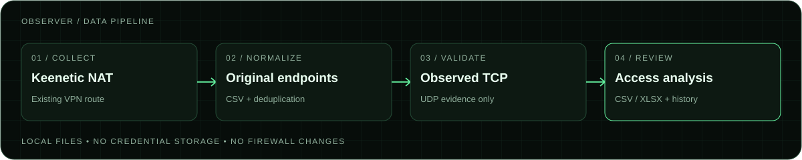

<div align="center">

<picture>
  <source media="(prefers-color-scheme: dark)" srcset="docs/media/observer-hero-dark.svg">
  <source media="(prefers-color-scheme: light)" srcset="docs/media/observer-hero-light.svg">
  
</picture>

[](https://github.com/KingProjects12/Observer-Control-Center/releases/latest)
[](https://github.com/KingProjects12/Observer-Control-Center/actions/workflows/windows-build.yml)


[](https://github.com/KingProjects12/Observer-Control-Center/releases)

**Network discovery · VPN analysis · TCP diagnostics · Connection history**

[](https://github.com/KingProjects12/Observer-Control-Center/releases/latest)

[Portable EXE](https://github.com/KingProjects12/Observer-Control-Center/releases/latest/download/Observer.ControlCenter.exe) · [Documentation](docs/WORKSPACE_GUIDE_EN.md) · [Changelog](CHANGELOG.md) · [Roadmap](ROADMAP.md)

**English** · [Русский](README_RU.md)

</div>

## Network intelligence, locally

Observer Control Center is a Windows desktop console for authorized network administrators. Collect observations from managed Keenetic routers, identify which devices reach office services, validate observed TCP destinations and prepare evidence for administrator-reviewed access rules.

**2.1.0 — Access Analyzer:** collection, cleanup, diagnostics and period comparison in one release. Windows builds and offline tests passed. Live validation of the new version remains necessary.

<picture>
  <source media="(prefers-color-scheme: dark)" srcset="docs/media/observer-demo-dark.svg">
  <source media="(prefers-color-scheme: light)" srcset="docs/media/observer-demo-light.svg">
  
</picture>

> **Concept preview, not an actual application screenshot.** All counters and statuses above are illustrative; no customer network data is included.

## Core features

| Module | Capability | Status |
| :--- | :--- | :--- |
| Network discovery | Read-only Keenetic NAT snapshots, up to 100 explicitly supplied router addresses | 🟢 Implemented |
| VPN Remote | Existing authorized route, per-router progress and colored logs | 🟢 Implemented |
| Access analyzer | Normalize, deduplicate, filter directions, group IP / port / protocol and source rules | 🟢 Implemented |
| TCP diagnostics | Check observed private TCP destinations; distinguish open, refused and timeout | 🟢 Implemented |
| Retry | Incomplete routers, session-only individual credentials, cumulative reports | 🟢 Implemented |
| Connection history | Compare two selected CSV periods; report changes in endpoints and sources | 🟢 Implemented |
| TOP Traffic | Four monitor windows, device ranking and CSV/XLSX reports | 🟢 Implemented |
| Self-update | Verified EXE replacement, backup and restart | 🟢 Implemented |
| UDP service validation | UDP observations retained; no TCP-based UDP test | 🟡 Observation only |

Status describes implementation, not live service availability or universal router compatibility.

## Architecture

<picture>
  <source media="(prefers-color-scheme: dark)" srcset="docs/media/observer-architecture-dark.svg">
  <source media="(prefers-color-scheme: light)" srcset="docs/media/observer-architecture-light.svg">
  
</picture>

- **Collect:** NAT or existing central-flow CSV; original snapshots and individual reports remain local.
- **Normalize:** validate original IPv4 endpoints, direction and ports; deduplicate repeated imports without overwriting originals.
- **Validate:** optional authorized TCP connect checks of observed destinations only. No application payload.
- **Review:** export evidence, compare periods and review service ownership before changing firewall rules.

<details>
<summary><strong>Report formats and history</strong></summary>

| Output | Purpose |
|---|---|
| `Office_Connections_All_Routers.xlsx` | Multi-router NAT report |
| `07_Office_To_Connections.csv` | Original office-destination observations |
| `00_Router_Status.csv` | Router coverage and failures |
| `Office_Access_Analysis.xlsx` | Access analysis workbook |
| `Office_IP_Port.csv` | Unique endpoints by protocol |
| `Office_Source_Rules.csv` | Source-to-office relationships |
| `Import_Audit.csv` | Import and cleanup audit |
| `Office_Changes.csv` / `Office_Source_Changes.csv` | Period comparison, when requested |

Local root: `%LOCALAPPDATA%\KeeneticObserver\Results\`. Retry is scoped to the current collector window; history is based on saved CSVs.

</details>

## Quick start

1. Download the latest Windows x64 installer from [Releases](https://github.com/KingProjects12/Observer-Control-Center/releases/latest), or use the portable EXE.
2. Open **Connect / NAT** or **VPN REMOTE** if an authorized VPN is already connected.
3. Enter managed router IPv4 addresses (one per line), credentials and the office IPv4 /24. Prefer HTTPS; HTTP only on trusted authorized networks.
4. Select **Collect NAT**. Review per-router status, then open reports or **Analyze access**.
5. Select original NAT CSV files, analyze, optionally check observed TCP destinations and export. Compare two periods separately if needed.

[Workspace guide](docs/WORKSPACE_GUIDE_EN.md) · [2.1.0 test checklist (RU)](docs/TEST_2.1.0_RU.md)

<details>
<summary><strong>Installation, updates and Windows security</strong></summary>

- Installer: `Observer-Control-Center-Setup-<version>-win-x64.exe`.
- Portable: `Observer.ControlCenter.exe`.
- Both are self-contained. Windows 10/11 x64; installer language is retained during updates.
- Use **Tools → Updates** for the official EXE update. Save reports before restart.
- Builds are not signed with a trusted Authenticode certificate; do not disable Windows protection. SHA-256 verifies integrity, not publisher identity.

</details>

## Development roadmap

| Milestone | Scope | State |
|---|---|---|
| 2.0.17 | Network diagnostics and cleanup | Integrated into 2.1.0 |
| 2.0.18 | Advanced discovery, per-router credentials and retry | Integrated into 2.1.0 (manual address verification) |
| 2.0.19 | Connection history and period comparison | Integrated into 2.1.0 |
| [2.1.0](https://github.com/KingProjects12/Observer-Control-Center/releases/tag/v2.1.0) | Network Intelligence Platform | Released |

[Full roadmap](ROADMAP.md) · [Changelog](CHANGELOG.md) · [Release notes](https://github.com/KingProjects12/Observer-Control-Center/releases)

<details>
<summary><strong>Build from source / technical requirements</strong></summary>

Windows 10/11 x64, .NET 10 SDK or Visual Studio with desktop development.

```powershell
git clone https://github.com/KingProjects12/Observer-Control-Center.git
cd Observer-Control-Center
dotnet run --project Tests/Observer.UpdateTests.csproj -c Release
dotnet run --project LegacyCollectorTests/LegacyCollectorTests.csproj -c Release
dotnet build Observer.ControlCenter.csproj -c Release
.\Publish-SingleExe.cmd
```

Output: `dist\Observer.ControlCenter.exe`. GitHub Actions artifacts are not GitHub Releases. Existing UI uses WPF transparency (not Acrylic blur), near-black panels, mini island, cyan/lavender accents and English/Russian localization. x-ndw4 is not supported.

</details>

<details>
<summary><strong>Limitations, privacy and license</strong></summary>

Use only on authorized networks. VPN REMOTE does not create a tunnel. NAT snapshots do not capture all LAN/VPN flows; absence from a report is not grounds to block access. An open TCP port does not prove service identity or business need. UDP is observed, not validated. No firewall changes or persistent credential storage. Keep internal addresses, raw dumps and reports private.

The interface is independently developed with visual inspiration from [Atoll](https://github.com/Fuwni/dynamic-island-windows); retain applicable MIT notices if Atoll code is incorporated. Observer's license has not yet been selected. Public availability alone does not grant redistribution rights.

</details>

---

<div align="center">

**OBSERVER — Network Intelligence Platform**

[Releases](https://github.com/KingProjects12/Observer-Control-Center/releases) · [Issues](https://github.com/KingProjects12/Observer-Control-Center/issues) · [Русский README](README_RU.md)

</div>
