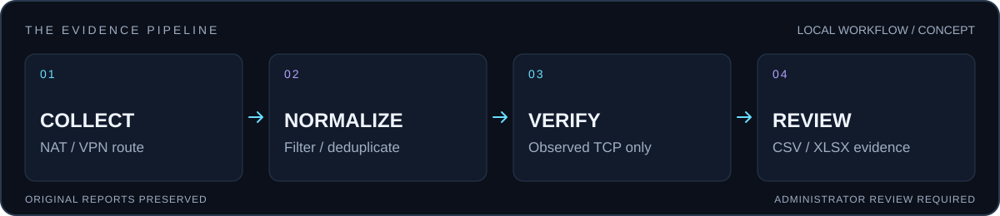

<div align="center">

<picture>
  <source media="(prefers-color-scheme: dark)" srcset="docs/media/signal-hero-dark.svg">
  <source media="(prefers-color-scheme: light)" srcset="docs/media/signal-hero-light.svg">
  
</picture>

[](https://github.com/KingProjects12/Observer-Control-Center/releases/latest)
[](https://github.com/KingProjects12/Observer-Control-Center/actions/workflows/windows-build.yml)


[](https://github.com/KingProjects12/Observer-Control-Center/releases)

**Understand network connections before changing access rules.**

[](https://github.com/KingProjects12/Observer-Control-Center/releases/latest)

[Portable EXE](https://github.com/KingProjects12/Observer-Control-Center/releases/latest/download/Observer.ControlCenter.exe) · [Documentation](docs/WORKSPACE_GUIDE_EN.md) · [All releases](https://github.com/KingProjects12/Observer-Control-Center/releases)

**English** · [Русский](README_RU.md)

[Capabilities](#01--capabilities) · [Workflow](#02--workflow) · [Quick-start](#03--quick-start) · [Release notes](#04--release-notes)

</div>

---

## Network visibility, without configuration changes

Observer Control Center is a Windows desktop console for authorized network administrators. It connects read-only to managed Keenetic routers, processes existing observations and helps prepare evidence for access reviews. Reports stay local; network configuration stays untouched.

| Read-only by design | Local-first reports | Evidence, not assumptions |
| :--- | :--- | :--- |
| No router configuration or firewall changes. | Original snapshots and CSV/XLSX exports. | Observe, optionally validate TCP, review manually. |

## 01 / Capabilities

### 01 · Network Discovery

Read-only Keenetic NAT snapshots from up to 100 explicitly supplied IPv4 addresses.

### 02 · VPN Remote

Collect through an existing authorized VPN route; per-router progress, colored logs and retry.

### 03 · Access Analyzer

Normalize and deduplicate observations; group by IP, port, protocol and source-to-destination relationship.

### 04 · TCP Diagnostics

Optional checks of observed private TCP destinations: open, refused or timeout.

### 05 · Connection History

Compare two saved CSV periods to identify changes in endpoints and sources.

### 06 · TOP Traffic

Four monitoring windows, device ranking and local CSV/XLSX reports.

Also included: individual session-only credentials for retry, cumulative reports, central-flow CSV import, English/Russian WPF interface, Black Liquid Glass styling (WPF transparency, not Acrylic), mini island, cyan/lavender accents, and verified EXE self-update with backup and restart.

UDP observations are retained, not service-tested. Feature descriptions refer to implementation, not verified availability on every router.

## 02 / Workflow

<picture>
  <source media="(prefers-color-scheme: dark)" srcset="docs/media/signal-flow-dark.svg">
  <source media="(prefers-color-scheme: light)" srcset="docs/media/signal-flow-light.svg">
  
</picture>

| Stage | What happens |
| :--- | :--- |
| **01 / Collect** | Capture authorized NAT observations or import existing central-flow CSV. |
| **02 / Normalize** | Validate IPv4 endpoints, direction and ports. Remove duplicate imports without overwriting originals. |
| **03 / Verify** | Optionally check observed private TCP destinations without application payload. |
| **04 / Review** | Export evidence, compare periods and verify service ownership before approving access rules. |

<details>
<summary><strong>Report files and local storage</strong></summary>

| File | Purpose |
| :--- | :--- |
| `Office_Connections_All_Routers.xlsx` | Merged multi-router NAT report |
| `07_Office_To_Connections.csv` | Original office-destination observations |
| `00_Router_Status.csv` | Router coverage and failures |
| `Office_Access_Analysis.xlsx` | Access analysis workbook |
| `Office_IP_Port.csv` | Unique endpoints by protocol |
| `Office_Source_Rules.csv` | Source-to-office relationships |
| `Import_Audit.csv` | Import and cleanup audit |
| `Office_Changes.csv / Office_Source_Changes.csv` | Period comparison |

Local root: `%LOCALAPPDATA%\KeeneticObserver\Results\`.

Retry applies to the current collector window; history is based on saved CSV files.

</details>

## 03 / Quick start

| Distribution | Recommended for |
| :--- | :--- |
| [Windows installer](https://github.com/KingProjects12/Observer-Control-Center/releases/latest) | Regular use; shortcut and selected interface language. |
| [Portable EXE](https://github.com/KingProjects12/Observer-Control-Center/releases/latest/download/Observer.ControlCenter.exe) | Launch without installation. |

Both distributions are self-contained for Windows 10/11 x64.

1. Open **Connect / NAT**, or **VPN REMOTE** if the authorized VPN is already connected.
2. Enter managed router IPv4 addresses, one per line, credentials and the office IPv4 /24. Prefer HTTPS; use HTTP only on a trusted authorized network.
3. Collect NAT and review per-router status. Retry incomplete routers if needed.
4. Open **Analyze access**, select original CSV reports, analyze and export. TCP verification and period comparison are optional.

**[Read the workspace guide →](docs/WORKSPACE_GUIDE_EN.md)**

> [!IMPORTANT]
> The builds do not yet have a trusted Authenticode signature. Do not disable Windows protection. SHA-256 verifies file integrity, not publisher identity.

## 04 / Release notes

### [2.1.0 — Access Analyzer](https://github.com/KingProjects12/Observer-Control-Center/releases/tag/v2.1.0)

The access analysis workflow brings collection, cleanup, TCP diagnostics, retry and period comparison together. The 2.0.17–2.0.19 development milestones were integrated into 2.1.0, not published separately.

| Version | Milestone |
| :--- | :--- |
| 2.1.0 | Access Analyzer, diagnostics and connection history |
| 2.0.16 | Multi-router NAT and combined reports |
| 2.0.15 | Workspace guide, UI and installer refinements |
| 2.0.12 | Original collector integrated into WPF |

Release documentation records successful Windows builds and offline tests; live validation of 2.1.0 on authorized networks is still needed.

[Full changelog](CHANGELOG.md) · [Roadmap](ROADMAP.md) · [Test checklist (RU)](docs/TEST_2.1.0_RU.md)

<details>
<summary><strong>Build from source</strong></summary>

Windows 10/11 x64 and .NET 10 SDK or Visual Studio with .NET desktop development.

```powershell
git clone https://github.com/KingProjects12/Observer-Control-Center.git
cd Observer-Control-Center
dotnet run --project Tests/Observer.UpdateTests.csproj -c Release
dotnet run --project LegacyCollectorTests/LegacyCollectorTests.csproj -c Release
dotnet build Observer.ControlCenter.csproj -c Release
.\Publish-SingleExe.cmd
```

Output: `dist\Observer.ControlCenter.exe`. GitHub Actions artifacts are not GitHub Releases. For self-update use Tools → Updates and save reports before restart; installer language is retained.

</details>

## Responsible use

Observer is intended for networks you own or administer with permission. VPN REMOTE does not create a tunnel. NAT snapshots can miss LAN/VPN flows; absence from a report is not a reason to block access. An open TCP port does not prove service identity or business need. UDP is observed but not validated. x-ndw4 is unsupported. Credentials are not persisted; keep internal addresses, raw dumps and customer reports private.

The interface is independently developed with visual inspiration from [Atoll](https://github.com/Fuwni/dynamic-island-windows). Retain applicable MIT notices if Atoll code is incorporated. Observer's license has not yet been selected; public source availability alone does not grant redistribution rights.

---

<div align="center">

**OBSERVER / CONTROL CENTER**

Clarity before configuration.

[Download](https://github.com/KingProjects12/Observer-Control-Center/releases/latest) · [Report an issue](https://github.com/KingProjects12/Observer-Control-Center/issues) · [Documentation](docs/WORKSPACE_GUIDE_EN.md)

</div>
