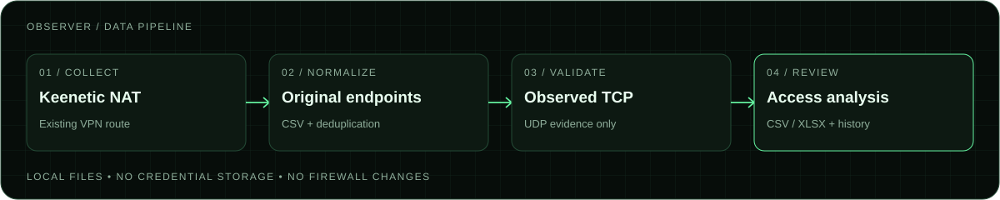

<div align="center">

<picture>
  <source media="(prefers-color-scheme: dark)" srcset="docs/media/observer-hero-dark.svg">
  <source media="(prefers-color-scheme: light)" srcset="docs/media/observer-hero-light.svg">
  
</picture>

[](https://github.com/KingProjects12/Observer-Control-Center/releases/latest)
[](https://github.com/KingProjects12/Observer-Control-Center/actions/workflows/windows-build.yml)


[](https://github.com/KingProjects12/Observer-Control-Center/releases)

**Сбор подключений · Анализ VPN · Диагностика TCP · История наблюдений**

[](https://github.com/KingProjects12/Observer-Control-Center/releases/latest)

[Portable EXE](https://github.com/KingProjects12/Observer-Control-Center/releases/latest/download/Observer.ControlCenter.exe) · [Документация](docs/WORKSPACE_GUIDE_RU.md) · [История версий](CHANGELOG.md) · [Roadmap](ROADMAP.md)

[English](README.md) · **Русский**

</div>

## Сетевая аналитика — локально

Observer Control Center — приложение Windows для уполномоченных сетевых администраторов. Собирает наблюдения с управляемых Keenetic, помогает определить, какие устройства обращаются к офисным сервисам, проверяет доступность наблюдаемых TCP-назначений и готовит данные для согласования сетевых правил.

**2.1.0 — Access Analyzer:** сбор, очистка, диагностика и сравнение периодов в одном релизе. Windows-сборки и офлайн-тесты прошли. Новый функционал необходимо проверить на разрешённой реальной сети.

<picture>
  <source media="(prefers-color-scheme: dark)" srcset="docs/media/observer-demo-dark.svg">
  <source media="(prefers-color-scheme: light)" srcset="docs/media/observer-demo-light.svg">
  
</picture>

> **Концептуальный макет, не скриншот приложения.** Все числа и состояния демонстрационные, реальных данных объектов нет.

## Основные возможности

| Модуль | Возможности | Статус |
| :--- | :--- | :--- |
| Network Discovery | Снимки NAT, до 100 явно заданных IP роутеров | 🟢 Реализовано |
| VPN REMOTE | Существующий VPN-маршрут, прогресс и цветной журнал | 🟢 Реализовано |
| Access Analyzer | Очистка, направление, IP / порт / протокол, связи источников | 🟢 Реализовано |
| TCP Diagnostics | Проверка наблюдаемых частных TCP-назначений, открыто / отказ / тайм-аут | 🟢 Реализовано |
| Повторный сбор | Проблемные роутеры, индивидуальные данные входа на сессию, дополнение отчёта | 🟢 Реализовано |
| Connection History | Сравнение двух CSV-периодов по назначениям и источникам | 🟢 Реализовано |
| TOP Traffic | Четыре периода, рейтинг устройств, CSV/XLSX | 🟢 Реализовано |
| Самообновление | Проверка EXE, резервная копия, перезапуск | 🟢 Реализовано |
| UDP | Сохранение наблюдений без проверки через TCP | 🟡 Только наблюдение |

Статусы обозначают реализацию функций, а не результаты подключения или совместимость со всеми роутерами.

## Архитектура

<picture>
  <source media="(prefers-color-scheme: dark)" srcset="docs/media/observer-architecture-dark.svg">
  <source media="(prefers-color-scheme: light)" srcset="docs/media/observer-architecture-light.svg">
  
</picture>

- **Сбор:** NAT или CSV центрального шлюза; исходные снимки и отчёты остаются локально.
- **Очистка:** проверка IPv4, направления и портов, исключение повторного импорта без изменения оригиналов.
- **Проверка:** отдельная разрешённая TCP-проверка наблюдаемых назначений, без прикладных данных.
- **Анализ:** экспорт доказательств, сравнение периодов и согласование назначения сервисов до изменения правил.

<details>
<summary><strong>Форматы отчётов и история</strong></summary>

| Файл | Назначение |
|---|---|
| `Office_Connections_All_Routers.xlsx` | Общий NAT по роутерам |
| `07_Office_To_Connections.csv` | Исходные наблюдения в офис |
| `00_Router_Status.csv` | Охват и ошибки сбора |
| `Office_Access_Analysis.xlsx` | Полный анализ доступов |
| `Office_IP_Port.csv` | Уникальные назначения с протоколом |
| `Office_Source_Rules.csv` | Связи источник → офис |
| `Import_Audit.csv` | Аудит импорта и очистки |
| `Office_Changes.csv` / `Office_Source_Changes.csv` | Изменения между периодами |

Папка: `%LOCALAPPDATA%\KeeneticObserver\Results\`. Повторный сбор работает в текущем окне, история основана на сохранённых CSV.

</details>

## Быстрый старт

1. Скачайте [последний релиз](https://github.com/KingProjects12/Observer-Control-Center/releases/latest) для Windows x64.
2. Откройте «Подключение / NAT» или VPN REMOTE при уже подключённом разрешённом VPN.
3. Введите IPv4 роутеров по одному на строку, данные входа и сеть офиса /24. Предпочтителен HTTPS; HTTP — только в доверенной разрешённой сети.
4. Нажмите «СОБРАТЬ NAT», проверьте статусы, откройте отчёты или «АНАЛИЗ ДОСТУПОВ».
5. Выберите исходные CSV NAT, запустите анализ, при необходимости TCP-проверку и экспорт. Для сравнения выберите два периода отдельно.

[Инструкция по рабочей области](docs/WORKSPACE_GUIDE_RU.md) · [Чек-лист 2.1.0](docs/TEST_2.1.0_RU.md)

<details>
<summary><strong>Установка, обновления и безопасность Windows</strong></summary>

- Установщик: `Observer-Control-Center-Setup-<version>-win-x64.exe`.
- Portable: `Observer.ControlCenter.exe`.
- Обе сборки самодостаточны, Windows 10/11 x64. Язык установщика сохраняется при обновлении.
- «Инструменты → Обновления» — замена официального EXE с проверкой SHA-256, резервной копией и перезапуском.
- Доверенной Authenticode-подписи пока нет. Не отключайте защиту Windows. SHA-256 подтверждает целостность, но не личность издателя.

</details>

## Дорожная карта

| Этап | Задача | Состояние |
|---|---|---|
| 2.0.17 | Очистка и диагностика TCP | Включено в 2.1.0 |
| 2.0.18 | Повторный сбор и индивидуальная авторизация | Включено в 2.1.0 (IP проверяется вручную) |
| 2.0.19 | История и сравнение периодов | Включено в 2.1.0 |
| [2.1.0](https://github.com/KingProjects12/Observer-Control-Center/releases/tag/v2.1.0) | Network Intelligence Platform | Опубликовано |

[Полная дорожная карта](ROADMAP.md) · [История версий](CHANGELOG.md) · [Релизы](https://github.com/KingProjects12/Observer-Control-Center/releases)

<details>
<summary><strong>Сборка из исходников и технические требования</strong></summary>

Windows 10/11 x64, .NET 10 SDK или Visual Studio с разработкой классических приложений .NET.

```powershell
git clone https://github.com/KingProjects12/Observer-Control-Center.git
cd Observer-Control-Center
dotnet run --project Tests/Observer.UpdateTests.csproj -c Release
dotnet run --project LegacyCollectorTests/LegacyCollectorTests.csproj -c Release
dotnet build Observer.ControlCenter.csproj -c Release
.\Publish-SingleExe.cmd
```

Результат: `dist\Observer.ControlCenter.exe`. Артефакт CI не равен релизу GitHub. Интерфейс: WPF Black Liquid Glass (прозрачность, не Acrylic), мини-островок, бирюзовый/лавандовый акцент, русский и английский. x-ndw4 не поддерживается.

</details>

<details>
<summary><strong>Ограничения, конфиденциальность и лицензия</strong></summary>

Только разрешённые сети. VPN REMOTE не создаёт туннель. Снимки NAT могут не показать часть LAN/VPN-потоков, отсутствие записи не означает ненужность доступа. Открытый TCP-порт не доказывает назначение сервиса. UDP наблюдается, но не проверяется. Observer не меняет правила и не хранит пароли на диске. Внутренние IP, дампы и отчёты не публикуйте.

Интерфейс разработан самостоятельно с визуальным вдохновением от [Atoll](https://github.com/Fuwni/dynamic-island-windows); при использовании кода Atoll необходимо сохранять применимые уведомления MIT. Лицензия Observer пока не выбрана, публичность репозитория не означает право распространения.

</details>

---

<div align="center">

**OBSERVER — Network Intelligence Platform**

[Релизы](https://github.com/KingProjects12/Observer-Control-Center/releases) · [Сообщить о проблеме](https://github.com/KingProjects12/Observer-Control-Center/issues) · [English](README.md)

</div>
